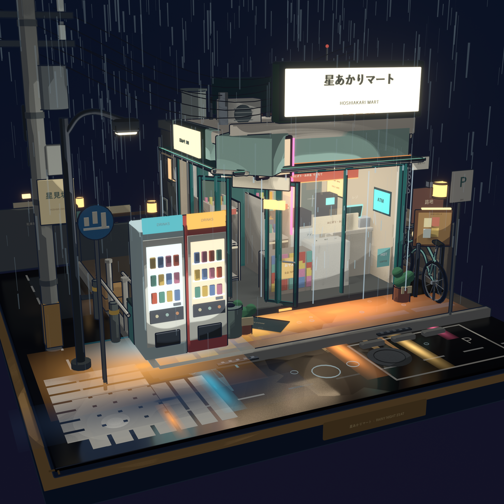
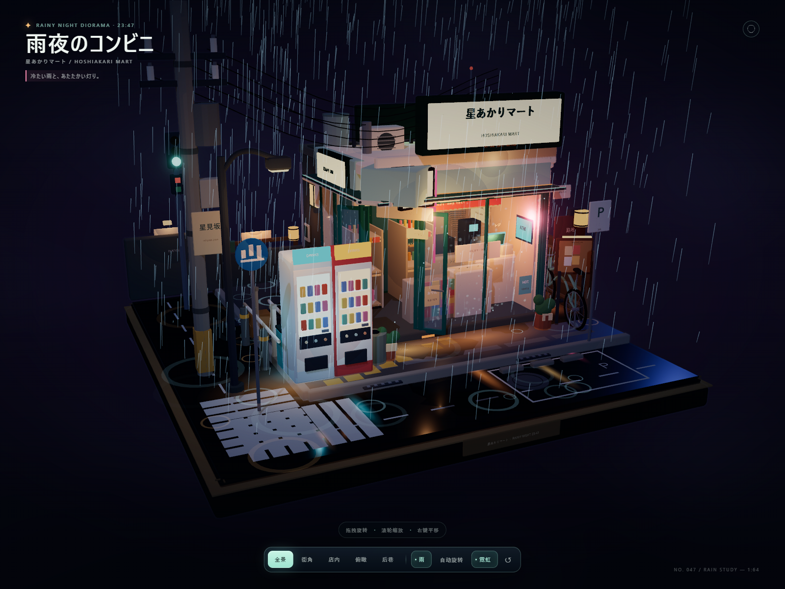
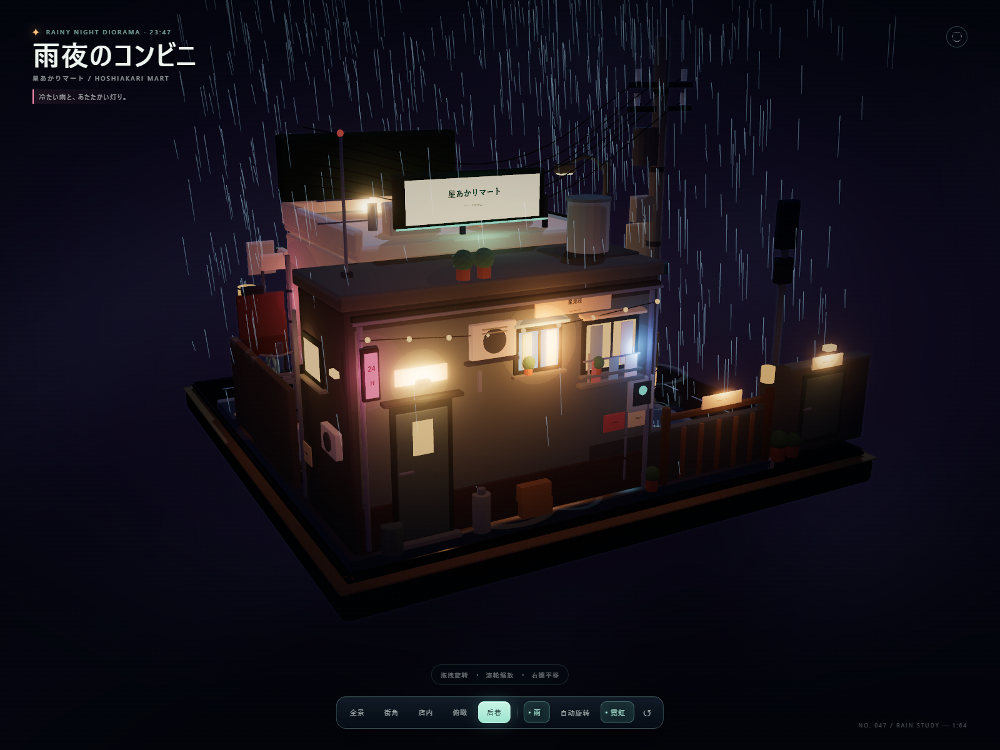

# 雨夜のコンビニ · Hoshiakari Mart

一个原创的日式雨夜便利店街角微缩场景：Blender 5.2 三渲二场景 + 可离线打开的 Three.js 交互式查看器。







## 打开方式

### 1. 直接看交互式 3D 场景（推荐）

双击打开：

`dist/hoshiakari-mart-rainy-night.html`

它是一个约 26.1 MB 的单文件版本，Three.js、UI、GLB 模型全部内嵌，断网也可以运行。若浏览器允许本地文件 WebGL，直接用 `file://` 打开即可。也可以通过本地服务器访问：

```powershell
npm start
```

终端会输出：

`http://127.0.0.1:5188/`

### 2. 打开 Blender 工程

用 Blender 5.2 或更新版本打开：

`HoshiakariMart_RainyNight.blend`

工程中包含完整场景、相机、灯光、三渲二材质、Freestyle 线集、Compositor 与 240 帧动画时间线。

## 交互动画与镜头

- 拖拽旋转、滚轮缩放、右键平移。
- 镜头预设：全景 / 街角 / 店内 / 俯瞰 / 后巷。
- 雨：开关持续降雨、玻璃雨痕、檐口滴水与积水涟漪。
- 自动旋转：缓慢环绕模型。
- 霓虹：开关霓虹反射与 Bloom 辉光。
- `H`：隐藏 / 显示 UI；`R`：重置；`Space`：自动旋转；`1–5`：快速切换机位。
- 自动门每约 18 秒开合一次，主招牌与灯箱有轻微随机闪烁，远处信号灯循环变色。
- 后巷立面新增暖色窗、胜手口/后门、空调、电表、燃气管、晾衣杆、木门、串灯、24H 霓虹、屋顶水箱/天线与背面店招，并配有专属「后巷」机位。

## 场景内容

- 完整正方形展示底座 7.2 × 7.2 m，带倒角、黄铜饰边与铭牌。
- L 形街角道路、反光斑马线、停车位、排水沟、积水、湿地霓虹倒影、路缘石与护栏。
- 便利店：发光招牌、玻璃橱窗、切角自动门、雨棚、门垫、橱窗海报、竖向 24H 灯箱。
- 店内：饮料柜、冰柜、饭团/便当冷柜、三排货架、杂志架、收银台、POS 机、咖啡机、关东煮台、热食柜、后场门、储物柜、地面导视、海报与灯箱。
- 室外：自动贩卖机 ×2、自行车、伞架、分类垃圾桶、路灯、电线杆与下垂电线、路牌、停车标识、空调外机、公告栏、小巷入口、远处信号灯、自行车与盆栽。
- 后巷：星見荘公寓的背面立面、暖/冷双色窗、后门与胜手口灯、空调与电表、燃气管、洗衣晾晒、木门与串灯、24H 霓虹、水箱、天线与便利店背面店招。
- 无人物；使用原创品牌「星あかりマート / HOSHIAKARI MART」，不包含真实品牌或版权素材。

## 文件结构

```text
HoshiakariMart_RainyNight.blend    # Blender 源场景
dist/
  hoshiakari-mart-rainy-night.html # 单文件离线交互查看器
  scene.glb                        # 导出模型（查看器构建时的中间产物）
renders/
  hero.png                         # 2048² Blender 主视觉
  interior-detail.png              # 1600² 店内细节
  street-detail.png                # 1600² 街角细节
  back-detail.png                  # 1600² 后巷/背面立面细节
  viewer-hero.png                  # 1600×1200 实时查看器全景
  viewer-back.png                  # 1600×1200 实时查看器后巷机位
  viewer-mobile.png                # 390×844 移动端布局
scripts/
  build_scene.py                   # 程序化搭建、材质、灯光、动画、保存 .blend
  scene_lib.py                     # 基础几何体、材质、文字、曲线、软光等工具
  export_glb.py                    # 卡通节点 → PBR 近似材质并导出 GLB
  render_stills.py                 # 三张精修图渲染脚本
web/
  index.template.html
  style.css
  src/main.js                      # Three.js 查看器、雨、门、霓虹、UI
  build.mjs                        # esbuild 打包 + 单文件内联
  serve.mjs                        # 本地静态服务器
```

## 重新构建

环境：Windows、Blender 5.2.1 LTS、Node.js 24、npm 11。当前机器上的 Blender 路径为：

`C:\Users\48749\AppData\Local\Programs\Blender Foundation\Blender 5.2\blender.exe`

```powershell
$blender = 'C:\Users\48749\AppData\Local\Programs\Blender Foundation\Blender 5.2\blender.exe'

# 1. 重新生成 .blend
& $blender --background --factory-startup --python scripts\build_scene.py

# 2. 导出 GLB（在内存中替换材质，不覆盖 .blend）
& $blender --background HoshiakariMart_RainyNight.blend --python scripts\export_glb.py

# 3. 重新打包单文件查看器
npm install
npm run build:web

# 4. 本地预览
npm start
```

按需重渲染：

```powershell
& $blender --background HoshiakariMart_RainyNight.blend --python scripts\render_stills.py -- --res 2048 --samples 64 --shot hero --out renders\hero.png
& $blender --background HoshiakariMart_RainyNight.blend --python scripts\render_stills.py -- --res 1600 --samples 48 --shot interior --out renders\interior-detail.png
& $blender --background HoshiakariMart_RainyNight.blend --python scripts\render_stills.py -- --res 1600 --samples 48 --shot street --out renders\street-detail.png
& $blender --background HoshiakariMart_RainyNight.blend --python scripts\render_stills.py -- --res 1600 --samples 48 --shot back --out renders\back-detail.png
```

## 技术说明

- Blender 材质使用 Diffuse → Shader to RGB → 多级 ColorRamp 的卡通着色，Freestyle 只对主要建筑和大件道具出线，避免店内小物产生噪声。
- 玻璃低不透明度、招牌低强度发光、暖色室内面光 + 冷色环境光，配合 Compositor Fog Glow 与假霓虹反射卡营造雨夜氛围。
- Web 查看器将导出的 GLB 材质转换为 `MeshToonMaterial`，并用 `OutlinePass` + `UnrealBloomPass` + ACES 色调映射统一观感。
- 雨、涟漪、玻璃雨痕、自动门、招牌闪烁、信号灯均为实时程序化动画，不依赖视频或外部贴图。
- 查看器内置自适应移动端取景与 UI 布局，支持通过 `?preset=hero|street|interior|top|back`、`?ui=0`、`?debug=1` 做自动化截图与调试。
